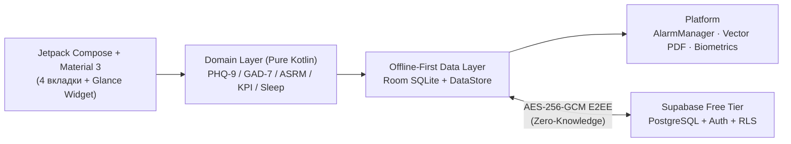

# Spectr

[](https://github.com/S4dK177y/spectr/actions/workflows/ci.yml)
[](LICENSE)

**Spectr** — приватное нативное open-source Android-приложение (Kotlin + Jetpack Compose + Material 3) для ежедневного трекинга эмоционального состояния, сна, энергии, тревоги, раздражительности и симптомов с авторасчётом клинических шкал (**PHQ-9**, **GAD-7**, **ASRM**), экспортом PDF-сводки для врача и опциональной облачной синхронизацией со сквозным шифрованием (**E2EE**).

---

## Ключевые возможности

- **Offline-first и режим без аккаунта:** работает мгновенно без интернета на базе локальной БД Room SQLite.
- **Гибридная модель дня:** 1 структурированный «Итог дня» (`-5..+5`, динамика, многофазный сон с авторасчётом часов, энергия, тревога, раздражительность, 7 симптомов со встроенными подсказками, заметка) + быстрые «Отметки момента» с точным временем.
- **Аналитика и шкалы:** помесячный цветной календарь настроения, 3 векторных графика, 14 KPI-метрик, автоматический маркер смешанного дня и авторасчёт шкал **PHQ-9**, **GAD-7**, **ASRM** с сохранением подтверждённых замеров.
- **Экспорт для врача:** офлайн-генерация векторного PDF-отчёта (с опциями включения/скрытия личных заметок) и чистый «Режим показа врачу» прямо с экрана.
- **Надёжные уведомления и виджет:** точные будильники `AlarmManager` (устойчивые к Doze и перезагрузке), умная отмена при заполнении, 14-дневное напоминание по шкалам и виджет `Jetpack Glance`.
- **Гибкая система тем:** Material 3 / Material You (`Pixel Dynamic Color`) + 3 встроенные палитры + светлый / тёмный / AMOLED режимы.
- **Zero-knowledge E2EE:** клиентское шифрование (`PBKDF2-HMAC-SHA256` 600k + `HKDF-SHA256` + `AES-256-GCM` с `AAD`) и строгий PostgreSQL RLS в Supabase — см. [SECURITY.md](SECURITY.md).

---

## Архитектура



Подробная документация:
- [Продуктовая спецификация](docs/SPEC.md)
- [Техническая архитектура и E2EE-протокол](docs/ARCHITECTURE.md)
- [Roadmap и журнал решений (ADR)](docs/ROADMAP.md)
- [Политика безопасности](SECURITY.md)

---

## Сборка и проверка

Требуется **JDK 21** и Android SDK (`minSdk = 26`).

```bash
# Стиль кода и статический анализ
./gradlew ktlintCheck detekt

# Юнит-тесты
./gradlew testDebugUnitTest

# Android Lint и сборка Debug APK
./gradlew lintDebug assembleDebug
```

---

## Лицензия

Распространяется под лицензией [MIT](LICENSE).
